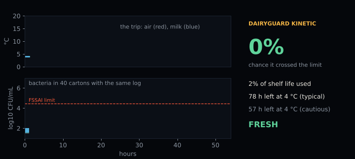
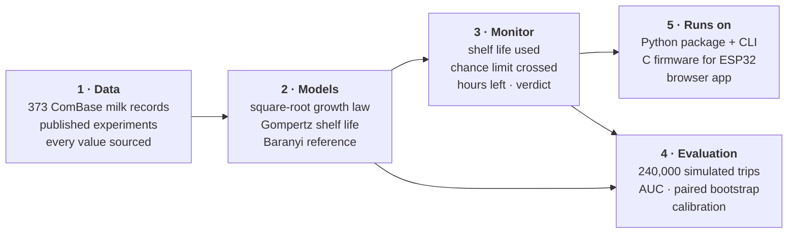
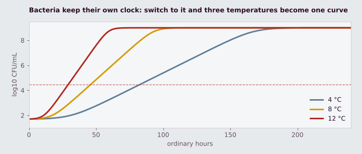
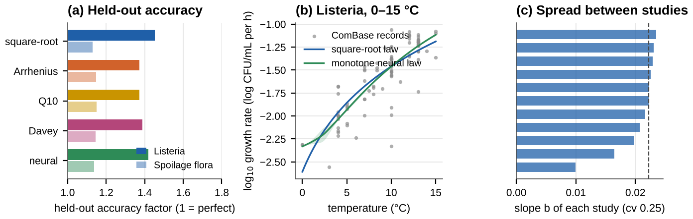
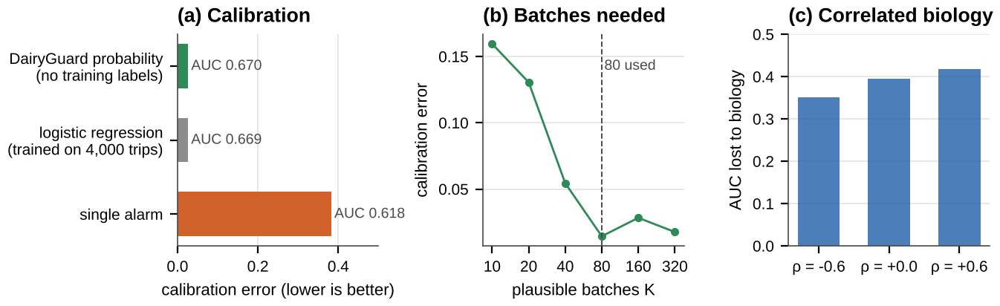

<p align="center"></p>

<h1 align="center">DairyGuard</h1>

<p align="center"><b>Reads a cold-chain temperature log and says how likely it is that milk has crossed its bacterial limit, and how sure it can be.</b></p>

<p align="center">
<a href="https://github.com/CopyNinja07-07/dairyguard/actions"></a>


</p>

<p align="center">
<a href="https://copyninja07-07.github.io/dairyguard/"><b>Website</b></a> ·
<a href="https://copyninja07-07.github.io/dairyguard/explorer.html"><b>Open the monitor</b></a> ·
<a href="docs/Beyond-the-4C-Alarm-DairyGuard.pdf"><b>The book</b></a> ·
<a href="docs/DairyGuard-White-Paper-WP01.pdf"><b>Architecture white paper</b></a>
</p>

<p align="center"></p>

<p align="center"><sub>One delivery, a three-hour warm spell. Same temperature log, 40 possible batches of milk: some cross the limit, some don't. DairyGuard reports the chance, live.</sub></p>

---

## Contents

[Why we started](#why-we-started) · [Quickstart](#quickstart) · [How it works](#how-it-works) · [How we collected the data](#how-we-collected-the-data) · [How we fitted and trained the models](#how-we-fitted-and-trained-the-models) · [How we tested it](#how-we-tested-it) · [Results](#results) · [The mathematics](#the-mathematics) · [Firmware](#firmware) · [Python API](#python-api) · [Repository map](#repository-map) · [Reproduce everything](#reproduce-everything) · [Limits](#limits) · [Next in our lab](#next-in-our-lab) · [Cite](#cite)

## Why we started

For the Smart India Hackathon our team designed a cold-chain pod for dairy logistics: an ESP32, a DS18B20 temperature probe and a Peltier cooler, with an app that warns when milk has been too warm for too long. Building its shelf-life model raised a question the hardware could not answer.

A logger records temperature faithfully. But whether milk spoils also depends on how many bacteria it started with, which kind, and how fast they wake up, and no thermometer sees any of that. So when a monitor gets it wrong, what is to blame: the cheap sensor, the reading interval, the formula, or the hidden biology? DairyGuard was built to measure each one, and then to turn the answer into a monitor that is honest about what it cannot know.

## Quickstart

```bash
git clone https://github.com/CopyNinja07-07/dairyguard.git
cd dairyguard
pip install -e .
dairyguard assess examples/truck_fridge_failed.csv
```

```text
DairyGuard Kinetic 2026.10  |  Pasteurised milk, psychrotrophic spoilage flora (literature parameters)
Log: 288 readings over 72.0 h, max 26.0 C, 5.0 h above 8 C in 1 warm event(s)

  Shelf life used (textbook batch)     127 %   [########################]
  Chance it crossed the limit           81 %   [###################.....]
  Hours left if held at 4 C              0 h   (typical batch)
  Hours left, cautious                   0 h   (9 batches in 10 reach this)

  Verdict: LIKELY OVER THE LIMIT
  Limit: FSSAI aerobic plate count limit for pasteurised milk, 3 x 10^4 CFU/mL
```

A log is any CSV with a temperature column and one of `time_h`, `time_min` or `timestamp`. Other commands:

```bash
dairyguard assess my_log.csv --product listeria --json   # machine-readable output
dairyguard shelf-life --temps 2 4 8 12                    # time to the limit at steady temperatures
dairyguard products                                       # milk, milk-combase, listeria
```

| Steady temperature | 2 °C | 4 °C | 8 °C | 12 °C |
|---|---|---|---|---|
| Time to the FSSAI limit (textbook batch) | 120 h | 83 h | 46 h | 29 h |

## How it works



The monitor does three things at every reading:

1. **Advances the biological clock.** Each reading adds `Δt / SL(T)` to the shelf life used, where `SL(T)` is the time the milk would last at that temperature.
2. **Carries 80 plausible batches along.** Each batch has its own growth rate, lag and starting count, drawn from the spread seen between real studies. The share of batches over the limit is the chance the limit was crossed.
3. **Turns that into a decision.** Fresh, use soon, check before use, or likely over the limit, with hours left if the milk is put back at 4 °C, typical and cautious.

<p align="center"></p>

<p align="center"><sub>Why a running total is enough: on the bacteria's own clock, growth at 4, 8 and 12 °C is one curve. Proof in the book, Chapter 4.</sub></p>

## How we collected the data

| Source | What we took | Used for |
|---|---|---|
| [ComBase](https://www.combase.cc), pasteurised milk | 51 growth rates of natural spoilage flora, 2.7 to 14.9 °C | fitting the `milk-combase` product |
| ComBase, *Listeria monocytogenes* in milk | 101 growth rates from 20 studies | fitting and held-out testing of five growth laws |
| ComBase, wider milk set | 373 records from 52 sources in total | between-study spread of growth rates |
| Lin et al. 2016 | milk at 4 °C with two 4-hour spells at 29 °C | a real fluctuating-temperature check |
| FSSAI standards | aerobic plate count limit for pasteurised milk, 3 × 10⁴ CFU/mL | the line that counts as "crossed" |
| Sensor datasheets | DS18B20 ±0.5 °C, PT1000 ±0.15 °C | sensor error in the simulator |

For every ComBase record we transcribed the organism, temperature, pH, water activity, source study and growth rate, and converted each rate from log₁₀ to natural-log units before fitting (a test guards this). Every parameter in the simulator is listed in [`data/params.csv`](data/params.csv) with its source, or marked ASSUMED where no source exists.

## How we fitted and trained the models

**Growth laws.** We fitted five laws for growth rate against temperature by least squares on log growth rates: the Ratkowsky square-root law, Arrhenius, Q10, Davey, and a monotone neural network.

**The neural law.** `sqrt(μ) = Σₖ exp(uₖ) · softplus(exp(vₖ)(T − cₖ)/10)`, four units, so the rate can only rise with temperature. It is trained with an L2 penalty as an ensemble of five networks from different starts, using `scipy.optimize.least_squares`. Code: [`src/dairyguard/growthlaws.py`](src/dairyguard/growthlaws.py).

**Judged on unseen data.** For *Listeria*, each of the 20 studies is left out in turn, every law is fitted on the other 19, and the held-out study is predicted. Spoilage flora use 5-fold cross-validation. Scores are the Ross bias and accuracy factors. Code: [`experiments/growth_law_study.py`](experiments/growth_law_study.py).

**Between-study spread.** A square-root law with one slope `b` per study and a shared `Tmin`, fitted to the 11 studies with three or more records, gives the real spread of growth rates between studies. That spread sets how widely the monitor's 80 batches are drawn.

## How we tested it

Nobody counts the bacteria in every real carton, so the monitor cannot be checked in the field yet. We built a virtual cold chain where the truth is always known:

| Part | Choice |
|---|---|
| Trips | fridge at 2.5 to 5 °C; warm events about once per 6 days, 10 min to 8 h, peaks 12 to 30.7 °C |
| Packaging | low-mass pouch (5 to 20 min time constant) or insulated crate (1 to 4 h) |
| Hidden biology | drawn per trip: growth slope (spread 0, 10 or 25%), minimum temperature, lag, starting count |
| Sensors | DS18B20, PT1000, ideal |
| Reading interval | 1, 15 or 60 min, or adaptive |
| Settings | 2 limits × 2 packagings × 3 biology spreads = 12, with 4,000 trips each |
| Worlds | baseline, extra lag, low starting load, ComBase-fitted flora, *Listeria*: **240,000 trips** |

The reference Baranyi–Roberts model decides the true outcome minute by minute; the monitor sees only the sensed, sampled log.

| Method | What it answers | Code |
|---|---|---|
| AUC (Mann–Whitney) | can a rule tell crossed cartons from safe ones? | `simulate.py` |
| Paired bootstrap, B = 400 | is rule A really better than rule B on the same trips? | `benchmark.py` |
| Brier score, calibration error | is "70%" right 70% of the time? | `simulate.py` |
| Ross bias and accuracy factors | how far off are predicted growth rates? | `growthlaws.py` |
| AICc | which growth law fits best for its complexity? | `growthlaws.py` |
| Spearman correlation | does "hours left" rank trips correctly? | `monitor_studies.py` |

**27 automated tests** pin the kinetics, unit conversions, headline numbers, the monitor, the growth laws, parity between the Python and browser code, and the firmware against Python. A full rerun reproduces every saved result exactly (all seeds fixed).

## Results

AUC is the chance that a delivery which crossed the limit scores higher than one that didn't: 0.5 is a coin flip, 1.0 is perfect.

**What limits a temperature monitor** <sub>(simulation)</sub>

| Finding | Number |
|---|---|
| Accuracy lost to the biology a thermometer cannot see | 0.27 to 0.40 AUC |
| Gained by a lab-grade PT1000 over a cheap DS18B20 | at most 0.02 AUC |
| Reading hourly instead of every minute | no detectable loss in 11 of 12 settings |
| Calibration error: DairyGuard's probability vs a single alarm | 0.03 to 0.07 vs 0.34 to 0.43 |
| Gap closed by one heat-flow (calorimetry) test of the batch | 69 to 94% |

**Against real data**

| Check | Result |
|---|---|
| Lin et al. 2016, fluctuating temperatures | time to 10⁶ CFU/mL: 53 h predicted, about 55 h measured |
| Spread of growth rates between 11 real studies | 25% (coefficient of variation of the slope) |
| Five growth laws on 20 unseen *Listeria* studies | accuracy factors 1.37 to 1.45; no law clearly best |
| Neural law vs square-root law | no gain on growth rates alone |

<p align="center"></p>

**The monitor under test** <sub>(simulation)</sub>

| Check | Result |
|---|---|
| DairyGuard's probability vs a logistic model trained on 4,000 labelled trips | equal AUC (0.675 vs 0.673) and calibration, with no labels needed |
| Number of plausible batches needed | calibration settles from 80 |
| Growth rate and lag correlated (ρ from −0.6 to 0.6) | loss to biology stays 0.35 to 0.42 AUC |
| Cautious "hours left" | safe on 99.9% of trips; typical estimate off by a median 16 h |

<p align="center"></p>

**In one sentence:** the accuracy of a temperature monitor is limited by biology, not by the thermometer, so effort is better spent measuring the milk than measuring its temperature more precisely.

## The mathematics

**Growth rate against temperature** (Ratkowsky square-root law, natural-log basis):

$$\sqrt{\mu(T)} = b\,(T - T_{\min})$$

**Reference growth model** (Baranyi–Roberts), with $y=\ln N$ and physiological state $q$:

$$\frac{dy}{dt} = \mu(T)\,\frac{q}{1+q}\left(1 - e^{\,y-y_{\max}}\right), \qquad \frac{dq}{dt} = \mu(T)\,q$$

**The biological clock.** Both equations carry the same factor $\mu(T)$. In generalized time

$$\tau(t) = \int_0^t \mu\big(T(s)\big)\,ds$$

temperature disappears from the equations, so the whole temperature history matters only through $\tau$. This is the analogue of Ozawa's generalized time in thermal analysis, and it explains why sensor precision and reading interval barely matter.

**Shelf life used.** With readings every $\Delta t$ and the Gompertz shelf life $SL(T)$:

$$\mathrm{CSL} = \sum_i \frac{\Delta t}{SL(T_i)}$$

Since $1/SL(T) \propto \mu(T)$, CSL is a discretised generalized time.

**Apparent activation energy.** The square-root law implies $E_{\mathrm{app}} = 2RT^2/(T - T_{\min})$, falling from 109 to 66 kJ/mol between 4 and 13 °C, which is why a fixed-activation-energy integrator does not do better in simulation.

**Calorimetry.** If heat flow is proportional to cell formation, $P/\mu = Y_Q V\,G(\tau)$: heat-flow curves from any temperature programme collapse onto one master curve, so one isothermal test measures the batch's own biology.

Full derivations are in [the book](docs/Beyond-the-4C-Alarm-DairyGuard.pdf), Chapter 4 and the appendices.

## Firmware

[`firmware/`](firmware) runs the same monitor on an ESP32 with a DS18B20 probe on GPIO 4 and green, amber and red LEDs on GPIO 25, 26 and 27.

- `dairyguard_monitor/dg_core.c`, `dg_core.h`: portable C99, no dynamic memory, 64 plausible batches in under 2 kB
- `dairyguard_monitor/dairyguard_monitor.ino`: reads the probe every 15 minutes, updates the core, lights the verdict, prints a status line over serial
- `firmware/host_test.c`: compiled and checked against the Python monitor by `tests/test_firmware.py`

```c
dg_monitor m;
dg_init(&m, &DG_MILK, 42);
dg_update(&m, temperature_C, 0.25f);          /* every 15 minutes */
dg_status s = dg_status_now(&m);              /* s.probability_crossed, s.state, ... */
```

## Python API

```python
from dairyguard import ColdChainMonitor

monitor = ColdChainMonitor("milk", n_draws=200, seed=0)
for _ in range(160):
    monitor.update(4.0, dt_hours=0.25)        # 40 h in the fridge
for _ in range(8):
    status = monitor.update(17.5, dt_hours=0.25)   # a 2 h warm spell

print(status.shelf_life_used)        # 0.60
print(status.probability_crossed)    # 0.05
print(status.hours_left_at_4C)       # about 31
print(status.state)                  # 'fresh'
```

```python
from dairyguard import growthlaws as gl
law = gl.MonotoneNet(units=4, ensemble=5).fit(T, mu)        # or SquareRoot(), Arrhenius(), ...
scores = gl.leave_one_group_out(gl.SquareRoot, T, mu, studies)
```

## Repository map

```
dairyguard/
├── src/dairyguard/        the package
│   ├── kinetics.py          growth rate, Gompertz shelf life, Baranyi model
│   ├── monitor.py           ColdChainMonitor: shelf life used, probability, hours left, verdict
│   ├── products.py          milk, milk-combase, listeria presets with sources
│   ├── growthlaws.py        five growth laws incl. a monotone neural law; cross-validation
│   ├── simulate.py          trips, hidden biology, sensors, sampling, scores
│   ├── benchmark.py         the full benchmark with paired bootstrap and calibration
│   ├── io.py · cli.py       log reading and the `dairyguard` command
├── firmware/              C core, ESP32 sketch, host test
├── experiments/           every study in the book, one script each
├── tests/                 27 automated tests
├── data/                  ComBase records and parameters with sources
├── results/               saved output of all runs
├── generated/             numbers, tables and figures written from results
├── examples/              two example temperature logs
├── report/ · whitepaper/  LaTeX sources of the book and the white paper
├── demo/                  source of the browser app
└── docs/                  website, app and PDFs (GitHub Pages)
```

## Reproduce everything

```bash
make test         # 27 tests, a few seconds
make validate     # real-data checks
make extensions   # growth-law study, monitor studies, figures, animations (a few minutes)
make runs         # the five simulated worlds, about three hours on two cores
make generated report whitepaper demo
```

Every number in the book and on the website is written from the result files by script, never typed by hand.

## Limits

- **The main results are simulated.** Trip patterns and several biological numbers are assumed and flagged in `data/params.csv`.
- **The heat-flow (calorimetry) result is simulated.** No milk has been measured in a calorimeter yet.
- **"Crossed the limit" means the modelled count passed the FSSAI hygiene limit.** It is not a taste test or a safety verdict.
- **Only temperature is modelled.** Spore-formers and other causes of spoilage are out of scope. *Listeria* results concern growth only.
- This is research software, not food-safety advice.

## Next in our lab

The results point in one direction: the 25% spread between real studies is biology a log cannot see, and a more flexible formula on growth rates alone does not recover it. Our next model keeps DairyGuard Kinetic's proven core and learns each batch's biology from complete growth curves of milk under changing temperatures, plus simple tests at loading. Over November and December we are building the growth-curve pipeline and the lab protocol; first measurements are planned for January and February 2027. See [ROADMAP.md](ROADMAP.md).

Have growth data, a microbiology lab or a calorimeter? [Offer data or lab access](https://github.com/CopyNinja07-07/dairyguard/issues/new?template=offer-data.yml).

## Cite

```
Singh SP. Beyond the 4 °C Alarm: What a Temperature Log Can and Cannot Tell About Milk Spoilage.
Self-published, Katra, 2026. https://github.com/CopyNinja07-07/dairyguard
```

Citation metadata is in [`CITATION.cff`](CITATION.cff). Code under the MIT licence; ComBase records remain subject to the ComBase terms of use. The book and white paper have not been peer reviewed.

<sub>Suryansh Pratap Singh · Department of Mathematics and Computing, Shri Mata Vaishno Devi University</sub>
