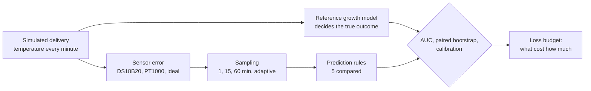

<p align="center"></p>

# DairyGuard

  

**How well can a temperature log predict whether milk has spoiled, and what limits it?**

A cold-chain logger records temperature. But bacterial growth also depends on things no thermometer sees: how many bacteria the milk started with, which strains, and how long they take to wake up. DairyGuard measures how much prediction accuracy is lost to each source of error, explains the result mathematically, and is now building a hybrid neural model to recover what the log cannot see.

**[Website](https://copyninja07-07.github.io/dairyguard/) · [Live demo](https://copyninja07-07.github.io/dairyguard/explorer.html) · [Technical Report TR-01](docs/DairyGuard-Technical-Report-TR01.pdf) · [White Paper WP-01](docs/DairyGuard-White-Paper-WP01.pdf) · [Roadmap](ROADMAP.md)**

**Contents:** [Key results](#key-results) · [How it works](#how-it-works) · [The mathematics](#the-mathematics) · [The statistics](#the-statistics) · [Simulation design](#simulation-design) · [Checks against real data](#checks-against-real-data) · [Quickstart](#quickstart) · [Code map](#code-map) · [What comes next](#what-comes-next) · [Limitations](#limitations) · [Cite](#cite-and-licence)

---

## Key results

Scores are the area under the ROC curve (AUC): the chance that a delivery which crossed the bacterial limit gets a higher risk score than one that didn't. 0.5 is a coin flip, 1.0 is perfect.

| Finding | Number | Evidence |
|---|---|---|
| Accuracy lost to the biology a thermometer cannot see | 0.27 to 0.40 AUC | simulation |
| Accuracy gained by a lab-grade PT1000 over a cheap DS18B20 | at most 0.02 AUC | simulation |
| Hourly logging vs logging every minute | no detectable difference in 11 of 12 settings | simulation |
| Growth-model score vs a plain degree-hour count | at most 0.04 AUC better | simulation |
| Arrhenius or Q10 integrators vs the square-root law | never better, in 60 of 60 settings | simulation |
| Calibration error of a probability vs a single alarm | 0.03 to 0.07 vs 0.34 to 0.43 | simulation |
| Gap closed by one calorimetric test of the batch | 69 to 94% | simulation |
| Prediction of a published fluctuating-temperature experiment | within 4% | real data |
| Held-out *Listeria* growth rates | accuracy factor 1.37 | real data |

**In one sentence:** the accuracy of a temperature monitor is limited by biology, not by the thermometer, so effort is better spent measuring the product than measuring its temperature more precisely.

## How it works

Nobody counts the bacteria in every real carton, so predictions can't be checked in the field. DairyGuard builds a virtual cold chain where the true answer is always known, ties every number in it to published experiments, and then removes information one source at a time.



The loss budget compares the same trips under shrinking information:

| Step | What the predictor knows |
|---|---|
| Oracle | true biology and true temperature |
| Biology-limited | true temperature, assumed biology |
| + sensor | sensed temperature, assumed biology |
| + sampling | sensed and sampled temperature, assumed biology |

## The mathematics

**Growth rate against temperature** (Ratkowsky square-root law; μ in h⁻¹, natural-log basis):

$$\sqrt{\mu(T)} = b\,(T - T_{\min})$$

**Reference growth model** (Baranyi–Roberts), with $y=\ln N$ and physiological state $q$:

$$\frac{dy}{dt} = \mu(T)\,\frac{q}{1+q}\left(1 - e^{\,y-y_{\max}}\right), \qquad \frac{dq}{dt} = \mu(T)\,q$$

**The biological clock.** Both equations are multiplied by the same $\mu(T)$. Changing the time variable to the generalized time

$$\tau(t) = \int_0^t \mu\big(T(s)\big)\,ds$$

removes temperature completely: $dy/d\tau$ and $dq/d\tau$ do not depend on $T$. So the whole temperature history matters only through $\tau$. This is the analogue of Ozawa's generalized time in thermal analysis, and it explains every result in the loss budget.

**Shelf life and consumed shelf life.** At a steady temperature the time to the limit $N_L$ is a closed-form Gompertz expression $SL(T)$. Along a logged trip with readings every $\Delta t$:

$$\mathrm{CSL} = \sum_i \frac{\Delta t}{SL(T_i)}, \qquad \text{predict "crossed" when } \mathrm{CSL} \ge 1$$

Because $1/SL(T) = \mu(T)/K$ for a constant budget $K$, CSL is just $\tau/K$, a discretised generalized time.

**Apparent activation energy.** The square-root law implies an Arrhenius slope that changes with temperature,

$$E_{\mathrm{app}} = \frac{2RT^2}{T - T_{\min}},$$

which falls from 109 to 66 kJ/mol between 4 and 13 °C. This is why a fixed-activation-energy integrator cannot beat the square-root law.

**Calorimetry.** If heat flow is proportional to the rate of cell formation, $P = Y_Q V\,dN/dt$, then

$$\frac{P(t)}{\mu(T(t))} = Y_Q V\,G\big(\tau(t)\big),$$

so heat-flow curves from any temperature programme collapse onto one master curve. An isothermal detection time $t_{\det}$ measures the batch's own growth rate, lag and starting load in one number, which is exactly the biology the log cannot see.

Proofs are in Appendix C of [TR-01](docs/DairyGuard-Technical-Report-TR01.pdf).

## The statistics

| Method | Used for | Where |
|---|---|---|
| AUC, by the Mann–Whitney rank statistic | ranking accuracy of each rule | `src/simulate.py`, `src/benchmark.py` |
| Paired bootstrap on identical trips (B = 400) | confidence intervals for differences between rules | `src/benchmark.py` |
| Hanley–McNeil standard error | sample size: 4,000 trips per setting | TR-01, Chapter 6 |
| Monte Carlo posterior over 80 biology draws | a probability instead of an alarm | `src/benchmark.py` |
| Brier score, expected calibration error (ECE) | is "70%" right 70% of the time? | `src/simulate.py` |
| Bias and accuracy factors (Ross 1996) | growth-rate fits against ComBase | `src/validate_combase*.py` |
| AICc model selection | four temperature laws compared | `src/compare_secondary.py` |

A difference between two rules is called detectable when its 95% paired-bootstrap interval excludes zero.

## Simulation design

| Part | Choice |
|---|---|
| Trips | fridge at 2.5–5 °C; warm events about once per 6 days, 10 min to 8 h, peaks 12–30.7 °C |
| Packaging | low-mass pouch (5–20 min time constant) or insulated crate (1–4 h) |
| Hidden biology | per trip: growth slope b (spread 0, 10 or 25%), minimum temperature, lag, starting count |
| Sensors | DS18B20 (±0.5 °C), PT1000 (±0.15 °C), ideal |
| Sampling | every 1, 15 or 60 min, or adaptive |
| Rules | maximum temperature, time above 5 °C, time above 8 °C, degree-hours above 4 °C, CSL |
| Settings | 2 limits × 2 packaging types × 3 biology spreads = 12, with 4,000 trips each |
| Worlds | baseline, extra lag, low starting load, ComBase-fitted flora, *Listeria*: 240,000 trips |

Every parameter and its source is in [`data/params.csv`](data/params.csv), marked SOURCED or ASSUMED.

## Checks against real data

| Check | Data | Result |
|---|---|---|
| Fluctuating-temperature experiment | Lin et al. 2016, milk at 4 °C with two 4-h spells at 29 °C | time to 10⁶ CFU/mL: 53 h predicted vs about 55 h measured |
| Natural spoilage flora | 51 ComBase records, pasteurised milk, 2.7–14.9 °C | real flora grow about 1.6× slower than lab strains |
| *Listeria monocytogenes* | 46 records to fit, 53 held out | held-out bias factor 1.02, accuracy factor 1.37 |
| Temperature laws | square-root, Arrhenius, Q10 and Davey laws on ComBase records | square-root law has the lowest AICc for both spoilage flora and *Listeria* |

## Quickstart

```bash
git clone https://github.com/CopyNinja07-07/dairyguard.git
cd dairyguard
pip install -r requirements.txt
make test        # 19 checks, a few seconds
make summary     # condense the saved results of all five worlds
```

Use the kinetic model directly:

```python
import sys; sys.path.insert(0, "src")
import numpy as np
from dg_kinetics import mu_sqrt, sl_gompertz

b, Tmin, h0, logN0, logNmax, limit = 0.030, -7.7, 3.8, 1.7, 9.0, 3e4

print(sl_gompertz(4.0, b, Tmin, h0, logN0, logNmax, limit))     # shelf life at 4 °C: about 83 h

# a trip logged every 15 min: 40 h cold, a 2 h warm spell at 17.5 °C, 10 h cold
log = np.r_[np.full(160, 4.0), np.full(8, 17.5), np.full(40, 4.0)]
csl = np.sum(0.25 / sl_gompertz(log, b, Tmin, h0, logN0, logNmax, limit))
print(f"shelf life used: {csl:.0%}")                             # 72%

# the biological clock: how many hours at 4 °C this trip is worth
print(np.sum(0.25 * mu_sqrt(log, b, Tmin)) / mu_sqrt(4.0, b, Tmin))   # about 59
```

Rebuild everything from scratch (about three hours on two cores, all seeds fixed):

```bash
make runs && make validate && make generated && make report && make whitepaper && make demo
```

## Code map

```
dairyguard/
├── src/
│   ├── dg_kinetics.py         growth rate, Gompertz shelf life, Baranyi model
│   ├── simulate.py            trips, hidden biology, sensors, sampling, scores, AUC
│   ├── benchmark.py           the full benchmark: paired bootstrap, probability forecasts
│   ├── validate_lin.py        reproduces Lin et al. 2016
│   ├── validate_combase.py    fits natural spoilage flora
│   ├── validate_combase_lis.py   fits and tests Listeria on held-out records
│   ├── compare_secondary.py   four temperature laws, AICc
│   ├── calorimetry_info.py    value of a calorimetric test of the batch
│   ├── example_setting.py     one setting in full detail
│   └── summarize_runs.py      condenses all runs into results/summary.json
├── tests/                     19 automated checks
├── results/                   saved output of the five worlds
├── data/                      parameters with sources, ComBase records
├── generated/                 numbers, tables and figures written from the results
├── report/                    source of Technical Report TR-01
├── whitepaper/                source of White Paper WP-01
├── demo/                      source of the browser demo
├── docs/                      the website, the demo and the PDFs (GitHub Pages)
├── ROADMAP.md                 the plan to February 2027
└── Makefile                   test, runs, validate, summary, generated, report, whitepaper, demo
```

## What comes next

**DairyGuard Neural**, a hybrid neural differential-equation model. It keeps the proven generalized-time core and learns three things from real data: the temperature response of real bacteria (a monotone neural growth law), departures from the textbook equations after temperature shifts (small residual networks), and the hidden state of each batch from cheap tests at loading (a variational encoder). It will be trained on ComBase growth curves and new laboratory counts of milk. The full design, data plan and evaluation rules are fixed in advance in [White Paper WP-01](docs/DairyGuard-White-Paper-WP01.pdf). The timeline is in [ROADMAP.md](ROADMAP.md).

Have growth data, a microbiology lab or a calorimeter? [Open an issue](https://github.com/CopyNinja07-07/dairyguard/issues/new?template=offer-data.yml).

## Limitations

- **The main results are simulated.** Trip patterns are assumed, and several biological numbers are assumed and flagged in `data/params.csv`. They describe a virtual cold chain, not field rates.
- **The calorimetry result is simulated.** No milk has been measured in a calorimeter yet.
- **"Spoiled" means the modelled count crossed a stated limit** (the FSSAI hygiene limit for pasteurised milk, or a growth target). It is not a sensory or safety verdict.
- **Only temperature is modelled.** Spore-formers and other causes of spoilage are out of scope.
- *Listeria* results concern growth only. No illness is modelled.
- This is research, not food-safety advice.

## Cite and licence

```
Singh SP. Beyond the 4 °C alarm: what a temperature log can and cannot tell about milk spoilage.
DairyGuard Technical Report DG-TR-01, 2026. https://github.com/CopyNinja07-07/dairyguard
```

Citation metadata is in [`CITATION.cff`](CITATION.cff). Code under the MIT licence. ComBase records remain subject to the ComBase terms of use.

**Author:** Suryansh Pratap Singh, Department of Mathematics and Computing, Shri Mata Vaishno Devi University.
