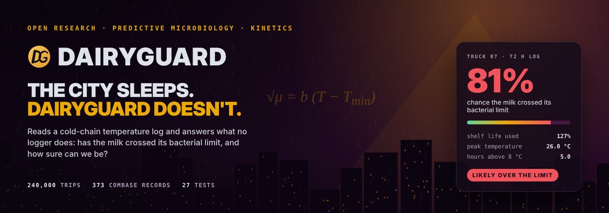
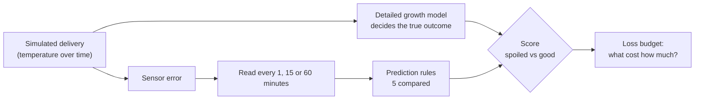
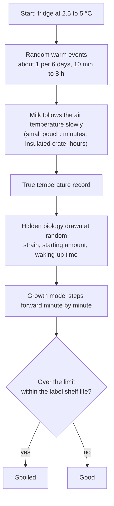

<p align="center"></p>

# DairyGuard

### What really decides whether milk goes bad on its way from the farm to your fridge?


A simulation study of the cold chain for milk. We built a virtual world of thousands of milk deliveries, so that we always know the true outcome, and used it to find out what limits our ability to predict spoilage from a temperature record: the thermometer, how often we read it, the rule we use, or something no instrument can see.

**[Website](https://copyninja07-07.github.io/dairyguard/) · [Live demo](https://copyninja07-07.github.io/dairyguard/explorer.html) · [Monograph (PDF)](docs/DairyGuard-Monograph.pdf) · [Roadmap](ROADMAP.md) · [Help us](#help-us)**

**Contents:** [The short version](#the-short-version) · [Problem](#problem) · [Approach](#approach-in-plain-words) · [Architecture](#architecture) · [Quickstart](#quickstart) · [The model](#the-model) · [The simulated world](#the-simulated-world) · [How methods are judged](#how-methods-are-judged) · [Is the model believable?](#is-the-model-believable) · [Results](#results) · [Model v1 and model v2](#model-v1-and-model-v2) · [Where this is going](#where-this-is-going) · [Help us](#help-us) · [Listeria case study](#listeria-case-study) · [Data](#data-and-parameters) · [Repository layout](#repository-layout) · [Limitations](#limitations) · [Next steps](#next-steps) · [Glossary](#glossary) · [Cite](#cite-and-licence)

---

## The short version

- Milk spoils because bacteria in it multiply, and they multiply much faster when it is warm.
- A short warm spell costs a lot. Growth speed rises faster than temperature: milk at 17.5 °C loses its shelf life about **4.6 times faster** than milk at 4 °C.
- We tested what limits prediction. **The biggest loss comes from what a thermometer cannot see:** which bacteria were in the milk and how many.
- A more accurate thermometer helps only a little (at most 2 points out of 100). Reading the temperature every hour instead of every minute made no measurable difference in most settings.
- So the money and effort are better spent on knowing the milk's starting condition, and on telling people the *chance* of spoilage instead of a plain red or green light.
- **New in model v2:** the maths explains why. Growth, and even the heat that growing bacteria give off, depend on the temperature record only through one running total. The formulas used in many shelf-life labels (Arrhenius, Q10) never did better than the square-root rule, in any of 60 settings. And one heat-flow (calorimetry) test of a batch, added to the temperature log, won back **69 to 94%** of the accuracy the thermometer could not provide.

All of this is in a simulation. See [Limitations](#limitations) before drawing conclusions.

*"Spoiled" in this project means the bacterial count crossed a chosen limit (the FSSAI hygiene limit for pasteurised milk, or a growth target). It is not a taste or smell test, and it is not a safety verdict.*

## Problem

Milk is kept cold so that bacteria grow slowly. Between the farm and your fridge, it is moved several times. A door is left open, a truck cooler struggles in summer heat, a crate waits on a loading bay.

Most monitors today work like a smoke alarm: they complain when the temperature crosses a limit, for example 5 °C or 8 °C. But bacteria do not follow our limit. Their growth speeds up smoothly as it gets warmer, so the damage depends on *how warm* and *for how long*. A simple limit throws that information away.

Why it matters beyond wasted food: the World Health Organization estimates that unsafe food makes about 600 million people ill and causes about 420,000 deaths every year, with about 175,000 of those deaths in South-East Asia. Cold, well-handled food is one of the simplest protections. (This project models spoilage and the growth of *Listeria*. It does not model illness.)

**The question:** when we try to predict whether milk will spoil from its temperature record, *where does the accuracy go?*

## Approach in plain words

In the real world nobody knows exactly how many bacteria are in every carton, so predictions cannot be checked. We therefore build the test like a school exam with an answer key.

1. **Make the exam.** Simulate thousands of milk deliveries, each with its own temperature history.
2. **Make the answer key.** For every delivery, a detailed biological growth model decides whether the milk really went over the spoilage limit.
3. **Hide the answers.** Give each prediction method only a noisy, infrequently read temperature record, and never the hidden biology.
4. **Mark the answers.** Score how well each method separates spoiled deliveries from good ones.
5. **Take things away one at a time.** Start from perfect knowledge, then add sensor error, then sparse reading. The drop at each step is how much that factor costs. We call this the **loss budget**.

## Architecture

The whole pipeline, from simulated trip to score:



What happens to a single simulated delivery:



## Quickstart

Python 3.10 or newer is needed.

1. Get the code.
   ```bash
   git clone https://github.com/CopyNinja07-07/dairyguard.git
   cd dairyguard
   ```
2. Install the libraries.
   ```bash
   pip install -r requirements.txt
   ```
3. Run the 19 automatic checks (a few seconds).
   ```bash
   make test
   ```
4. Condense the saved results of all five runs into one summary.
   ```bash
   make summary
   ```
5. Optional: repeat all simulations from scratch (about three hours on two processor cores).
   ```bash
   make runs
   ```
6. Optional: run a single simulated world yourself. Each world is chosen by a setting, and all random numbers are seeded, so reruns give the same results.
   ```bash
   DG_PARAMS=lis python3 src/benchmark_v2.py 4000 results/lis
   ```

## The model

Four formulas do all the work. Each is described in words first.

| # | In words | Code |
|---|---|---|
| 1 | **Temperature sets the growth speed.** Take the temperature, add an offset so that growth stops at the right place, multiply by a constant, and square the result. | `src/dg_kinetics.py` |
| 2 | **The detailed growth model (the answer key).** Cells first "wake up" (the lag phase), then multiply again and again, then level off near a ceiling. It handles any temperature history, because it takes the temperature at every minute. | `src/simulate.py` |
| 3 | **Shelf life at a steady temperature.** A closed-form shortcut: time spent waking up plus time spent growing to the spoilage limit. A small chip can compute it in one line. | `src/dg_kinetics.py` |
| 4 | **Consumed shelf life (CSL).** Each minute of a trip uses up a small fraction of the milk's life. Add the fractions up. At 1 (100%) the milk is predicted to have spoiled. | `src/simulate.py` |

In symbols, for readers who like them:

```
sqrt(mu) = b * (T - Tmin)                      growth speed mu at temperature T
SL(T)    = h0/mu + A/(mu10*e) * [1 - ln(-ln(L/A))]     shelf life at a steady T
CSL      = sum( dt / SL(T) ) over the readings  predict spoiled when CSL >= 1
```

Why the temperature matters so much, using the reference milk bacteria (growth stops near -7.7 °C):

| Steady temperature | Shelf life to the spoilage limit | Relative growth speed |
|---|---|---|
| 4 °C | 83 hours | 1.0× |
| 8 °C | 46 hours | 1.8× |
| 12 °C | 29 hours | 2.8× |
| 17.5 °C | 18 hours | 4.6× |

**Why two different models?** The answer key (formula 2) and the predictor (formulas 3 and 4) are deliberately built differently. If they were the same, the predictor would be marking its own homework and look unrealistically good.

## The simulated world

**Trips.** Each delivery starts at a random fridge temperature between 2.5 and 5 °C. Warm events arrive at random, on average once per 144 hours, last about an hour (10 minutes to 8 hours), and reach 12, 14.3, 17.5 or 30.7 °C. The milk does not jump to the air temperature; it follows it slowly. We simulate two kinds of pack: a low-mass pouch (responds in 5 to 20 minutes) and an insulated crate (1 to 4 hours).

**Hidden biology.** Each trip gets its own random growth constant, minimum growth temperature, waking-up time and starting amount of bacteria. The predictors never see these.

**Sensors.** Three are compared, using typical datasheet accuracy:

| Sensor | Offset | Noise | Smallest step |
|---|---|---|---|
| DS18B20 (common, cheap) | up to ±0.5 °C | 0.05 °C | 0.0625 °C |
| PT1000 (better) | up to ±0.15 °C | 0.03 °C | 0.03125 °C |
| Ideal | none | none | none |

**Reading rate.** Every minute, every 15 minutes, every hour, or *adaptive* (every 15 minutes while steady and in range, every minute when the temperature changes).

**Prediction rules compared.** All five see exactly the same readings from the same sensor.

| Rule | In words |
|---|---|
| Maximum temperature | the highest reading seen |
| Time above 8 °C | hours warmer than 8 °C |
| Time above 5 °C | hours warmer than 5 °C |
| Degree-hours | for each reading, degrees above 4 °C times hours, added up |
| CSL | the shelf-life model above |

**Settings.** Each run has 12 settings (2 spoilage limits × 2 pack types × 3 levels of strain variability) with 4,000 simulated trips each. There are five runs, so about 240,000 simulated outcomes in total.

| Run | What is different | Label shelf life (hours) |
|---|---|---|
| `base` | reference biology from published sources | 83 and 113 |
| `lag` | extra waking-up time after a temperature jump, which the predictor ignores | 83 and 113 |
| `low` | fewer bacteria at the start, as in real pasteurised milk | 120 and 154 |
| `comb` | growth numbers fitted to real ComBase milk-spoilage records | 201 and 258 |
| `lis` | *Listeria* instead of spoilage bacteria, with smaller growth targets | 100 and 202 |

The rule for what counts as "spoiled" was fixed **before** any method was compared, so the labels could not be tuned in anyone's favour.

## How methods are judged

- **AUC.** Pick one spoiled and one good delivery at random. AUC is the chance that the method gives the spoiled one the higher score. We report it out of 100: 50 is a coin flip, 100 is perfect. It needs no alarm threshold, so rules in different units can be compared fairly.
- **Oracle.** The shelf-life rule given the *true* hidden biology and the *true* temperature. It is the best the rule can do with perfect knowledge. The gap between the oracle and a realistic method is what is lost to what cannot be seen or measured.
- **Bootstrap.** To see how uncertain a score is, we repeat it on 200 reshuffled copies of the trips and report the middle 95%.
- **Paired bootstrap.** To compare two methods fairly, we resample the trips **once** and score both methods on that same sample. Because both methods see the same trips, their errors move together, and the comparison is much sharper. A difference is called *detectable* if its 95% range excludes zero.
- **Probability forecasts.** Instead of a yes/no alarm, we compute a probability by trying 80 plausible versions of the hidden biology and counting how many say "spoiled". We judge it with the **Brier score** (average squared error, lower is better) and **calibration** (when it says 70%, is it right about 70% of the time?), summarised as the **expected calibration error (ECE)**.

## Is the model believable?

Three checks, none of them circular:

1. **Reproducing a published experiment.** A 2016 study measured growth of milk bacteria at 4, 15 and 29 °C. We fitted our growth law to those rates only, then predicted two things that were *not* used in the fit.

   | | Published | This model |
   |---|---|---|
   | Time to a million per mL at a constant 4 °C | about 90 h | 90 h |
   | Same, with two 4-hour warm spells at 29 °C | about 55 h | 53 h (4% off) |

2. **Fitting real growth records.** 51 ComBase records of spoilage bacteria in pasteurised milk (2.7 to 14.9 °C): predictions are within a factor of about 1.6 on average (accuracy factor 1.62).
3. **Held-out test for *Listeria*.** 46 records used to fit, 53 kept hidden. On the hidden records, bias factor 1.02 and accuracy factor 1.37. The split was by experimental condition, not by study, so it is easier than a split by study.

## Results

All scores are **out of 100**, over the 12 settings of each run. The same pattern held in all five.

| Run | Lost to the biology we cannot see | Gain from the shelf-life rule over degree-hours | Gain from a better sensor | Reading hourly vs every minute |
|---|---|---|---|---|
| `base` | 27 to 40 | up to 2.3 | up to 1.5 | detectable in 1 of 12 |
| `lag` | 27 to 40 | up to 3.7 | up to 1.3 | detectable in 1 of 12 |
| `low` | 28 to 40 | up to 2.3 | up to 1.8 | detectable in 2 of 12 |
| `comb` | 28 to 40 | up to 2.5 | up to 1.5 | detectable in 0 of 12 |
| `lis` | 9 to 34 | up to 2.3 | up to 2.0 | detectable in 0 of 12 |

What this means:

- **Biology is the limit.** The unseen biology costs 9 to 40 points. No sensor or reading rate can recover it.
- **Simple rules come close.** The shelf-life rule beats plain degree-hours by only 0 to 4 points, but beats a "time above 5 °C" alarm by up to 10 points and a "maximum temperature" alarm by up to 16.
- **Sensor and sampling matter little.** The better sensor gains at most 2 points. The adaptive rule gave no detectable advantage either.
- **Say the uncertainty.** The probability forecast was better calibrated than a single alarm in every run (ECE about 0.02 to 0.11 against 0.34 to 0.45 for the spoilage runs), with one exception noted below.

## Model v1 and model v2

| | Model v1 | Model v2 (current) |
|---|---|---|
| Question | What limits a temperature monitor? | Why, and what would fix it? |
| Theory | Growth models, applied | Growth and its heat depend on the log only through one running total (generalized time) |
| Temperature laws | Square-root rule | Four laws compared on real records; Arrhenius and Q10 rules tested on 240,000 trips |
| Calorimetry | Not covered | One simulated heat-flow test of a batch closes 69–94% of the gap |

Model v1 is written up in a 9-page working paper, not peer reviewed: [`docs/DairyGuard-v1-Working-Paper.pdf`](docs/DairyGuard-v1-Working-Paper.pdf). Model v2 is described in the [monograph](docs/DairyGuard-Monograph.pdf) and will be written up in the technical reports below. The [live demo](https://copyninja07-07.github.io/dairyguard/explorer.html) shows both models judging the same 60 cartons side by side.

## Where this is going

DairyGuard is now a staged project. Each stage ends in something complete and public. The full plan is in [`ROADMAP.md`](ROADMAP.md).

| Stage | What it delivers | Status |
|---|---|---|
| 0. Model v1 and v2 | Simulation benchmark, theory, website and demo | Done |
| 1. Report 1: Framework | The idea and the mathematics, written up as a technical report | In progress |
| 2. Report 2: Model v3 | A hybrid model: physics core plus learned parts for the hidden biology | Next |
| 3. Report 3: Validation | Model v3 tested on real published growth data it has not seen | Planned |
| 4. Experiment and journal paper | Real milk measured at changing temperatures, then a peer-reviewed paper | Planned |

The big question for model v3: **which cheap test of the milk at loading buys the most accuracy?** Model v2 says the hidden biology is the limit. The next step is to find out how cheaply it can be measured.

## Help us

This project needs real data more than anything else.

- **Growth data.** If you have counts of bacteria in milk (or other chilled food) measured at changing temperatures, with the temperature log, we would like to test model v3 on them. Full credit is given.
- **Lab access.** A microbiology lab with incubators and plate counting would let us run the milk experiment in stage 4.
- **Bugs and questions.** Open an [issue](https://github.com/CopyNinja07-07/dairyguard/issues/new/choose).

To offer data or lab access, open an issue with the "Offer data or lab access" form and we will get in touch.

## *Listeria* case study

*Listeria monocytogenes* is a dangerous germ that can grow in the cold. We studied how its **growth** responds to the same temperature histories, using targets of +0.5 and +1 log10 growth over the starting amount. These are round-number growth targets, **not** regulatory limits, and no illness is modelled.

- *Listeria* is more sensitive to short warm spells than spoilage bacteria: its growth at 13 °C is **5.9 times** its growth at 4 °C, against about 3.1 to 3.4 times for spoilage bacteria.
- For the small +0.5 log target, even the oracle only reaches 88 to 93 out of 100, because that small a target sits where the closed-form shelf-life formula is a poor stand-in for the detailed model. Probabilities are poorly calibrated there (ECE 0.28 to 0.41), though still better than the alarm. For the +1 log target the probability is clearly better calibrated (ECE 0.08 to 0.20 against 0.34 to 0.41).

## Data and parameters

Every number the model uses is in [`data/params.csv`](data/params.csv), with where it came from:

- **SOURCED**: taken from published work (for example a 1995 thesis and the 2016 study above).
- **ASSUMED**: our own assumption, such as the strain spread, the waking-up time range and how often trucks warm up. These are flagged so nobody mistakes them for measurements.

Growth records come from [ComBase](https://combase.cc), a public database of microbial growth. The 373 milk records we compiled, and the 51 spoilage records used for fitting, are in [`data/`](data/README.md).

## Repository layout

```
dairyguard/
├── src/                      the model and the simulation (Python)
│   ├── dg_kinetics.py        the formulas: growth speed, shelf life
│   ├── simulate.py           trips, hidden biology, sensors, reading rates, scores, AUC
│   ├── benchmark_v2.py       runs everything, paired bootstrap, probability forecasts
│   ├── validate_lin.py       reproduces the published 2016 experiment
│   ├── validate_combase.py   fits spoilage bacteria to ComBase records
│   ├── validate_combase_lis.py   fits and tests Listeria
│   ├── compare_secondary.py  compares four temperature laws on ComBase records
│   ├── calorimetry_info.py   value of a calorimetric test of the batch
│   ├── example_setting.py    one setting in full detail, for the statistics figure
│   └── summarize_runs.py     condenses the five runs into results/summary.json
├── tests/                    19 automatic checks
├── results/                  saved output of the five runs
│   ├── base/ lag/ low/ comb/ lis/   one folder per run (AUC, paired differences, calibration)
│   ├── validation_*.json     outputs of the three validation checks
│   └── summary.json          ranges across all runs
├── data/
│   ├── params.csv            every parameter with its source or ASSUMED flag
│   └── README.md             about the ComBase records
├── report/                   numbers, tables and figures shared by the reports and the monograph
├── book/                     source of the monograph and its figures
├── demo/                     source of the interactive demo
├── docs/                     the website and the finished PDFs (served by GitHub Pages)
├── .github/workflows/        runs the tests on every push
├── Makefile                  one-word commands: test, runs, summary, report, book, demo
├── ROADMAP.md                the staged plan
├── CITATION.cff   LICENSE   requirements.txt
```

## Limitations

- **It is a simulation.** How often and how warm a truck gets are assumptions, not measurements from real trucks. The conclusions hold for this simulated world and need real logger data to confirm.
- **Several biology numbers are assumed**, including strain spread, the waking-up time and the starting amount of bacteria. They are flagged in `data/params.csv`, and five different settings test how much the conclusions depend on them.
- **The calorimetry tests are simulated.** No calorimeter measurement on milk has been made yet.
- **Only temperature is modelled.** Other causes of spoilage are out of scope.
- ***Listeria* is growth only.** No illness or dose is modelled, and the growth targets are not regulatory limits.
- The *Listeria* held-out test splits by condition, not by study, which is easier than a split by study.
- **Related products exist.** Temperature loggers and indicators are already sold, and similar prediction tools have been published. This project's contribution is the comparison of what limits accuracy, not a new sensor.
- This is research, not food-safety or medical advice.

## Next steps

The staged plan is in [`ROADMAP.md`](ROADMAP.md). In short:

- Validate with real logger data from actual deliveries, to replace the assumed warm-event pattern.
- Extend the growth records to more spoilage organisms.
- Use full growth curves, not only maximum rates, to test the waking-up behaviour after temperature jumps.
- Measure heat flow from real milk in a calorimeter under stepped temperatures, to test the master curve and the detection-time idea.

## Glossary

| Term | Plain meaning |
|---|---|
| Cold chain | the path of milk from farm to fridge, kept cold |
| Growth speed (μ) | how fast bacteria multiply, per hour |
| Lag | the "waking-up" time before bacteria start multiplying quickly |
| Shelf life | hours until bacteria reach the spoilage limit at a steady temperature |
| CSL | the fraction of a milk's shelf life used up along a trip |
| Oracle | a predictor given perfect knowledge, used as the best case |
| AUC | chance that a spoiled delivery scores higher than a good one (50 = coin flip) |
| Bootstrap | reshuffling the data many times to see how uncertain a number is |
| Calibration | whether "70% chance" really comes true about 70% of the time |
| Brier score | average squared error of a probability forecast; lower is better |
| Prevalence | share of deliveries that ended up spoiled |

## Cite and licence

Citation details are in [`CITATION.cff`](CITATION.cff). Released under the MIT licence.

**Authors:** Suryansh Pratap Singh (code, simulation and writing) and Prof. (Dr.) Neeraj Tripathi, School of Electronics and Communication Engineering, faculty guide and co-author of model v2. Both at Shri Mata Vaishno Devi University.
